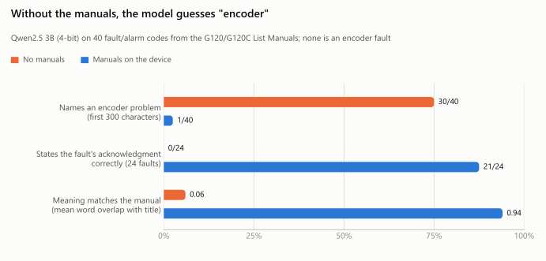
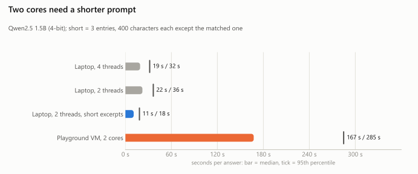
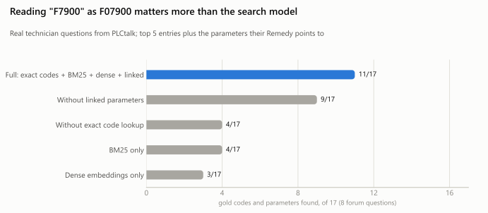
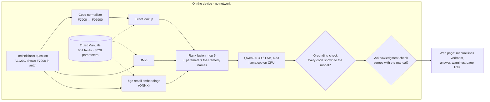

# A drive fault assistant that runs offline on two CPU cores and checks its own answers

[](https://github.com/vahit19/edge-diag-agent/actions/workflows/container.yml)


**Asked about 40 SINAMICS G120/G120C fault and alarm codes without the manuals, a 3B model named an
encoder problem in 30 of its answers; none of the 40 is an encoder fault. With the List Manuals
stored on the device it gets the meaning right (word overlap 0.94), and a check caught both of its
wrong acknowledgment instructions with no false alarm on the other 38 (the check was written after
seeing those two errors). In the Siemens Industrial
Edge Playground, limited to 2 cores and 3 GB, 39 of 40 answers passed both checks with 1.24 GiB of
memory.**

<picture>
  <source media="(prefers-color-scheme: dark)" srcset="docs/figures/manuals-dark.svg">
  
</picture>

**Contents:** [Headline results](#headline-results) · [Siemens Industrial Edge Playground](#in-the-siemens-industrial-edge-playground) · [Real questions from technicians](#real-questions-from-technicians) · [How it works](#how-it-works) · [Run it](#run-it) · [Limitations](#limitations)

An offline diagnostic assistant for Siemens SINAMICS G120 / G120C drives that runs on a few CPU
cores with no internet connection. A technician types what the drive shows, for example
"G120C shows F7900 when the conveyor starts in automatic mode". The assistant then:

1. finds the matching entries in the official List Manuals stored on the device;
2. answers with a small quantized language model (Qwen2.5 3B or 1.5B, 4-bit GGUF, llama.cpp);
3. checks the answer before showing it.

Each answer comes with manual pages the technician can open. The check flags any fault code or
parameter number the model was not shown. The fault's reaction and acknowledgment are copied
word for word from the manual and shown beside the model's text, never paraphrased.

Everything is measured end to end on real data: retrieval quality, answer correctness, latency
and memory. The numbers below come from `results/`, produced by `eval/run_eval.py`; the figures
are drawn from the same files by `python -m eval.figures`.

## Headline results

On 40 fault/alarm entries sampled from the manuals (seed 0), the model was asked
"The drive shows `<code>`. What does it mean and what should I do?":

| | 3B + manuals (default) | 1.5B + manuals | 3B, no manuals |
|---|---|---|---|
| Meaning matches the manual title (mean word overlap) | **0.94** | 0.83 | 0.06 |
| Fault acknowledgment stated correctly (24 faults) | **21/24** (88%, 95% CI 69–96) | 19/24 (79%, 60–91) | 0/24 |
| Fault acknowledgment stated wrongly | 2/24 (8%, 2–26) | 0/24 (0–14) | 0/24 |
| Answers naming a code or parameter it was not shown | 0/40 (0–9) | 1/40 (0–13) | n/a |
| Latency per answer, p50 / p95 (4 threads) | 32.9 s / 55.1 s | 19.2 s / 31.7 s | 12.4 s / 22.2 s |
| Peak memory (process RSS) | 3.9 GB | 2.2 GB | 3.7 GB |

Without the manuals, the same 3B model attributed 30 of the 40 codes to an encoder problem
within the first 300 characters of its answer (1/40 with the manuals). None of the 40 entries is an encoder fault. With the manuals it
gets the meaning right, but in 2 of 24 faults it copied the line "Reaction: NONE" as the
acknowledgment. The manual says "Acknowledge: POWER ON" for both.

The acknowledgment gate catches this kind of error: it compares the mode stated in the answer
with the manual entry. On these 40 answers it flagged both wrong ones (2/2) and none of the
other 38 (0/38). The gate was written after seeing these two errors, so this result shows the
gate works as designed. It is not an independent test. In the web page, the manual's own line
is always shown above the answer either way.

## In the Siemens Industrial Edge Playground

On 27 Oct 2026 the container was built and run in the Siemens Industrial Edge Playground (Virtual
Lab). The Playground's Industrial Edge Virtual Device (IEVD 1.24.2) has 2 x86-64 cores, 15.4 GB of
memory and 9.1 GB of free storage. Installing on the IEVD needs an `.app` package from the
Industrial Edge App Publisher, which was not available for this account. The container was therefore
run on the Playground's Ubuntu VM with the device's core count as the limit (`docker run --cpus 2
--memory 3g`, `DIAG_THREADS=2`). It was asked the same 40 manual questions through the HTTP API with
`scripts/bench_api.py`. The results are in `results/bench_vlab_playground_1.5b.json`.

| 1.5B model, 2 cores, 3 GB limit | Playground VM | Laptop, 4 threads |
|---|---|---|
| Answers passing both checks | 39/40 | 39/40 |
| Acknowledgment conflicts flagged | 0/40 | 0/40 |
| Latency per answer, p50 / p95 | 167 s / 285 s | 19.2 s / 31.7 s |
| Retrieval, p50 | 68 ms | about 30 ms |
| Peak container memory (`docker stats`) | 1.24 GiB | 2.2 GB (process RSS) |
| Ready after `docker run` | 5 s | n/a |

The one failure is the same entry in both runs: for F13009 the model named a parameter, r4956, that
does not exist in the manual, and the grounding check flagged it. Almost all the time goes to
generation, and two cores of this VM are about 9 times slower than four laptop threads. Answers of
nearly three minutes are too slow for interactive use. A check run of the rebuilt image with
networking disabled shows where the input goes: the F7900 question used 2,679 prompt tokens of
manual excerpts and produced 190 tokens. The memory figures use different tools and are not
directly comparable.

### Shorter excerpts for 2-core devices

Most of the prompt is context the answer does not need. With `DIAG_K=3 DIAG_EXCERPT_CHARS=400`
the agent retrieves 3 entries instead of 5 and cuts every excerpt except the exactly matched entry
at 400 characters; the matched entry stays whole. Measured on the laptop limited to 2 threads, all
49 questions (`python -m eval.run_eval answers --threads 2 --k 3 --other-chars 400`):

<picture>
  <source media="(prefers-color-scheme: dark)" srcset="docs/figures/latency-dark.svg">
  
</picture>

The laptop rows cover all 49 questions, the Playground row the 40 manual questions.

| 1.5B model, 2 threads | Default (5 entries, 1400 chars) | Short (3 entries, 400 chars) |
|---|---|---|
| Prompt tokens, median (manual set) | 2,560 | 941 |
| Latency per answer, p50 / p95 | 22.2 s / 36.4 s | **10.8 s / 18.3 s** |
| Manual answers passing the grounding check | 39/40 | 40/40 |
| Fault acknowledgment stated correctly / wrongly | 19/24 / 0/24 | 16/24 / 0/24 |
| Meaning overlap with the manual title | 0.83 | 0.85 |
| Forum gold items mentioned | 8/17 | 9/17 |

The answers are twice as fast. The cost is that 3 more answers leave the acknowledgment out (8/24
instead of 5/24); none states a wrong one, and the page shows the manual's acknowledgment line
above every answer anyway. The F13009 answer no longer invents a parameter, but one question is
not evidence of a trend. The defaults stay at 5 entries and 1400 characters. The short setting has
not yet been timed on the Playground VM; scaling its 167 s by the laptop ratio is an estimate,
not a measurement.

Building on the 2-core, 8 GB VM showed two problems that the GitHub runner did not. The embedding
index ran out of memory with fastembed's default batch of 256, so it now uses batches of 16. A
`chown -R` step copied the 1.19 GB application folder into a second image layer; `COPY --chown`
removes that copy. With both fixes the image built from scratch on the same VM, without swap, in
27 minutes; its disk usage fell from 5.53 GB to 3.18 GB (compressed content 2.54 GB to 1.38 GB).

## Real questions from technicians

The forum set has 9 real questions from public PLCtalk threads about G120/G120C drives. The gold
answer for each is the code(s) and parameter(s) named in the thread's resolution, checked
against the manual. The question texts are kept out of this repository; the threads are:

| Thread | Gold |
|---|---|
| [G120C DP 1910 fault](https://www.plctalk.net/forums/threads/g120c-dp-1910-fault.134179/) | F01910, p2040 |
| [Inverter Sinamics G120C](https://www.plctalk.net/forums/threads/inverter-sinamics-g120c.144942/) | F07807, p1901 |
| [G120C not running automatically](https://www.plctalk.net/forums/threads/g120c-not-running-automatically.135377/) | F07900, p1900 |
| [Sinamics G120 drive](https://www.plctalk.net/forums/threads/sinamics-g120-drive.119012/) | F30002, p1121 |
| [Built-in motor PTC with Siemens G120 VFD](https://www.plctalk.net/forums/threads/built-in-motor-ptc-with-siemens-g120-vfd.96052/) | r0035, p0601 |
| [How to reset G120 fault over Profinet](https://www.plctalk.net/forums/threads/how-to-reset-g120-fault-over-profinet.90356/) | p2103, r0054 |
| [TIA Portal Sinamics G120C doesn't start](https://www.plctalk.net/forums/threads/tia-portal-sinamics-g120c-doesnt-start.111058/) | r0046, r0054 |
| [Siemens G120 VSD flying start](https://www.plctalk.net/forums/threads/siemens-g120-vsd-flying-start.106779/) | A07409, A07910, F07900 |
| [Sinamics G120 VFD DI problem](https://www.plctalk.net/forums/threads/sinamics-g120-vfd-di-problem.96025/) | none: a wiring question the List Manual does not cover |

### Retrieval

The table counts gold items in the top 5 entries plus the linked parameters: 8 questions with
gold, 17 gold items.

<picture>
  <source media="(prefers-color-scheme: dark)" srcset="docs/figures/retrieval-dark.svg">
  
</picture>

| Configuration | Gold items found | Questions fully covered |
|---|---|---|
| Full: exact identifiers + BM25 + dense + linked parameters | **11/17** (65%, 95% CI 41–83) | 4/8 |
| Without linked parameters | 9/17 (53%) | 2/8 |
| Without exact identifier lookup | 4/17 (24%) | 1/8 |
| BM25 only | 4/17 (24%) | 2/8 |
| Dense embeddings only | 3/17 (18%) | 1/8 |

The biggest lever is plain code: technicians write "F7900", "O.F 7807" or "the 1910 error", and
normalising these to manual codes (F07900, F07807, F01910) before any fuzzy search takes
coverage from 24% to 65%. Retrieval takes about 30 ms.

### Answers

On the forum questions, all 9 answers from both models mentioned only codes and parameters the
model had been shown. The answers named 9/17 gold items with the 3B model and 8/17 with 1.5B,
limited by what retrieval found. Neither model declined the out-of-scope wiring question. The
page shows a warning when a question names no code found in the manuals, but one question is
too few to measure whether that is enough.

## How it works



| File | What it does |
|---|---|
| `diag/ingest.py` | Parses the List Manual PDFs: 661 fault/alarm entries (code, reaction, acknowledgment, cause, remedy) and 3028 parameter descriptions, cut by the PDF's own bookmark coordinates |
| `diag/retrieve.py` | Identifier normalisation, BM25, dense vectors, reciprocal-rank fusion, device filter, linked parameters |
| `diag/agent.py` | Prompt, local generation, grounding check, acknowledgment check |
| `diag/server.py` | FastAPI: `POST /api/ask`, `GET /api/health`, a one-page UI; one generation at a time |
| `eval/run_eval.py` | `retrieval`, `answers`, `rescore` modes; Wilson 95% intervals; `--threads`, `--k`, `--other-chars` |
| `eval/figures.py` | Draws the README figures (light and dark) from `results/*.json`; needs matplotlib |
| `scripts/bench_api.py` | Times a running service on the target device with the 40 manual questions; standard library only |
| `tests/` | Checks that need neither the manuals nor a model |

Knowledge base: the SINAMICS G120 Control Units CU240B-2/CU240E-2 List Manual (A5E33839529,
02/2023) and the SINAMICS G120C List Manual (A5E33840768, 02/2023). `scripts/fetch_data.py`
downloads both from Siemens' servers. They are not redistributed here.

## Run it

```bash
python -m venv .venv && . .venv/Scripts/activate        # or bin/activate
pip install --extra-index-url https://abetlen.github.io/llama-cpp-python/whl/cpu -r requirements.txt
python scripts/fetch_data.py                             # manuals, two GGUF models, parse
python -m diag.agent "G120C shows F7900 when running in automatic mode"
uvicorn diag.server:app --host 0.0.0.0 --port 8080       # http://localhost:8080
python -m eval.run_eval retrieval
python -m eval.run_eval answers --model data/models/qwen2.5-3b-instruct-q4_k_m.gguf --n 40
pip install pytest && pytest -q tests
```

The forum evaluation needs `data/eval/forum_questions.jsonl`. Each line has `id`, `device`,
`question` and `gold`. Write the questions from the threads above.

### Container

The `Dockerfile` bakes everything the device needs into the image at build time: the parsed
manuals, the embedding index and one model. At run time it has no network access
(`HF_HUB_OFFLINE=1`) and runs as a non-root user. `docker-compose.yml` follows the shape
Industrial Edge apps use: one service, a fixed tag, an explicit memory limit and a restart
policy. With the 3B model use 5 GB of memory; for a 3 GB budget, build with
`MODEL=qwen2.5-1.5b-instruct-q4_k_m.gguf`.

CI (`.github/workflows/container.yml`) builds the image with the 1.5B model and answers one
question inside it with networking disabled (`docker run --network none --memory 3g`). On the
first run the image was 2.95 GB. The answer took 62 s on 2 threads of a GitHub runner; it cited
F07900 from the G120C manual (p.709) and passed both checks. The image is not pushed anywhere.

## Limitations

- **Small sets.** 9 forum questions, 40 manual entries. The confidence intervals are wide and
  are reported with every number.
- **The forum set was also used for tuning.** Linked-parameter expansion was added after looking
  at its misses. A held-out set of new threads is needed before quoting the retrieval number as
  a generalisation estimate.
- **The manual set is easier than real questions.** It asks for one code by name, so it tests
  reading and reporting rather than diagnosis.
- **Simple scoring.** Meaning is scored by word overlap with the manual title, and
  acknowledgment by the mode stated next to the word "acknowledge". Both are rough checks;
  answers were also read by hand for the failure cases above.
- **Not measured on industrial hardware.** The main timings are from a laptop CPU (Intel
  i7-13800H) limited to 4 threads. The Playground run used a cloud VM limited to the virtual
  device's 2 cores, not the device itself and not a physical industrial PC.
- **Questions without a code** are the weak case, for example "47F, speed controller
  inhibited". Retrieval misses the status parameters they need (r0046, r0054). The List
  Manual also lacks wiring and commissioning steps; the operating instructions, which cover
  them, are not in the knowledge base.
